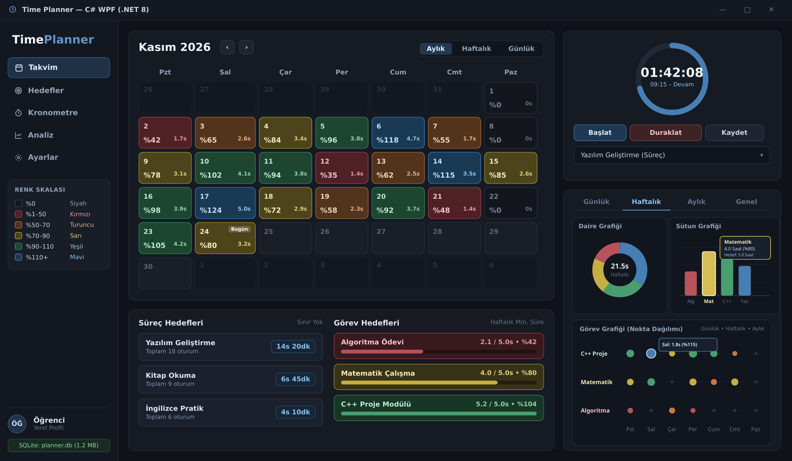

# TimePlannerApp — Zaman Planlama ve Çalışma Takip Uygulaması

Cihazın sistem tarih ve saatini doğrudan okuyarak çalışan; 3 farklı takvim görünümü, dairesel halkalı kronometre, Süreç/Görev hedef yönetimi, performansa dayalı dinamik renklendirme + parlama efektleri ve oyun arayüzü hissiyatında etkileşimli `LiveCharts2` grafikleri sunan yerel bir Windows masaüstü uygulaması (**C# / .NET 8 WPF + SQLite**).

## Öne Çıkan Özellikler

* **3 Modlu Takvim:**
  * **Aylık Görünüm:** Pazartesi–Pazar 7 sütunlu grid, ay/yıl seçicileri, bugüne özel `Bugün` vurgusu ve performans renklendirmesi.
  * **Haftalık Görünüm:** Aktif haftanın 7 gününü hedef, gerçekleşen süre ve oturum özetleriyle listeler.
  * **Günlük Görünüm (`00:00 – 23:59`):** Kaydedilen çalışma oturumlarını saat aralıklarına göre görsel bloklar halinde gösterir ve canlı sistem saati çizgisini taşır.
* **Hedef Yönetimi & Günlük Saat Ayarları:**
  * **Süreç Hedefleri (`Process`):** Sınırsız toplam süre ve oturum takibi.
  * **Görev Hedefleri (`Task`):** Haftalık minimum hedef süreye göre dinamik ilerleme çubuğu ve parlama efekti.
  * **Ayarlar:** Pazartesi–Pazar her gün için özelleştirilebilir günlük hedef çalışma süresi.
* **Kronometre & Oturum Kaydı:**
  * Kaymasız `DispatcherTimer` + `DateTime.Now` tabanlı kronometre (`Başlat / Duraklat / Kaydet / Sıfırla`), gece yarısı geçiş bölmesi ve günlük oturum geçmişi.
* **Dinamik Performans Renk Skalası & Parlama (`DropShadowEffect`):**
  * `%0` Siyah (`#121212`) → `%1–50` Kırmızı (`#E53935`) → `%50–70` Turuncu (`#FB8C00`) → `%70–90` Sarı (`#FDD835`) → `%90–110` Yeşil (`#43A047`) → `%110+` Mavi (`#1E88E5`).
* **Analiz Paneli (`LiveCharts2`):**
  * **Günlük / Haftalık / Aylık / Genel** zaman filtreleriyle **Daire (Donut)** ve **Sütun (Column)** grafikleri.
  * Görev hedefleri için **Günlük / Haftalık / Aylık** **Nokta Dağılımı (Scatter/Dot Plot)**.
  * Fare etkileşimli animasyonlu vurgu/parlama ve oyun *item kartı* tarzında özel tooltip.

## Teknoloji Yığını

* **Platform & UI:** C# (.NET 8) — WPF (XAML), Koyu Tema (Dark Mode)
* **Veritabanı:** Yerel SQLite (`Microsoft.Data.Sqlite` → `planner.db`)
* **Grafikler:** `LiveChartsCore.SkiaSharpView.WPF` (SkiaSharp)

## Kurulum ve Çalıştırma

Önkoşul: Windows üzerinde **.NET 8 SDK** (veya `.NET 8 Desktop Runtime` + daha yeni .NET SDK).

```powershell
dotnet restore TimePlannerApp/TimePlannerApp.csproj
dotnet run --project TimePlannerApp/TimePlannerApp.csproj
```

Uygulama ilk açıldığında çalışma dizininde `planner.db` dosyasını ve gerekli tabloları (`DailyTargets`, `Goals`, `WorkSessions`) otomatik oluşturur.

## Tasarım Referansı


